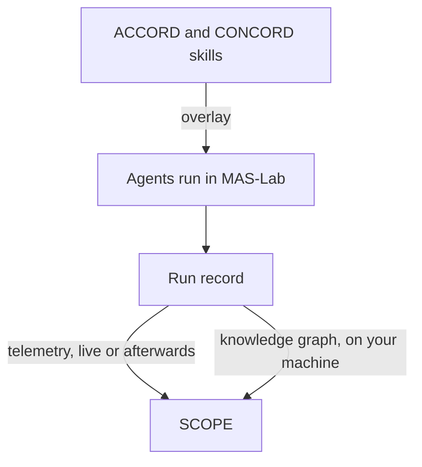

<!--
  Copyright (c) 2026 Cisco Systems, Inc. and its affiliates
  SPDX-License-Identifier: Apache-2.0
-->

# IoC integrations

How the protocols go in, and how the runs come out

MAS-Lab sits between the two other IoC components. The **Cognition Protocols**
enter it as skills that change how agents behave. The record of every run leaves
it for **SCOPE**, which explains what the agents did. This page follows both paths.

## Cognition Protocols go in as skills

### What a skill is

A **skill** is a folder that teaches an agent how to do one thing. Think of it as a
recipe card the agent keeps in a drawer. At the start of a task the agent sees only
the card's title and a one-line summary. When the task calls for it, the agent
pulls the card out and reads the full instructions, along with any reference notes
or helper scripts kept in the same folder.

Skills follow the open [agentskills.io](https://agentskills.io/) standard, which
many coding agents already understand. A skill written once works in all of them.

### Why the protocols are skills

ACCORD and CONCORD are conversations with a fixed shape: who speaks first, what
each agent sends, when the exchange ends. Packaging them as skills means no agent
has to be rewritten to use them. Each protocol comes as two skills, matching the
two roles in the conversation:

| Skill | Given to | What it lets the agent do |
|---|---|---|
| **Initiator** | The agent that leads, usually the one that owns the task | Open the exchange, collect the answers, and close it with a result |
| **Receiver** | Every agent taking part | Recognise the exchange and reply in the expected form |

[Cognition Protocols](https://ioc-project.github.io/cognition-protocols/) explains
what each protocol does.
[CONCORD installation](https://ioc-project.github.io/cognition-protocols/concord/installation/)
shows how to add the skills to any agent, inside or outside MAS-Lab.

### Why develop a skill in MAS-Lab

MAS-Lab supports the agentskills.io standard in full. It finds the skills of each
agent, shows the agent their summaries, loads the instructions only when asked, and
runs the scripts a skill carries.

That makes MAS-Lab a good workbench for a skill. You can add the skill to some
agents and not others, watch in the record exactly when each agent chose to read
it, and measure what changed. The skill itself stays an ordinary folder, so what you
validate in MAS-Lab is what you ship to other agents.

### How a protocol is tested

The skills are added with an **overlay**, a change kept apart from the system's own
description (see [Four ideas to know](../index.md#four-ideas-to-know)). The test then
compares two versions of the same team:

1. **Without the protocol.** The team as described, on a set of questions whose
   right answers are known.
2. **With the protocol.** The same team, the same questions, with one overlay that
   gives the lead the initiator skill and every other agent the receiver skill.

Each version runs several times, and the two are compared on whether the agents
agreed, whether the answer was right, and what the protocol cost. Because the
overlay is the only difference, the gap between the two versions is what the
protocol adds. The same method tests ACCORD alone, CONCORD alone, or both together.

- [Tutorial 6 — Agent skills](../tutorials/06-agent-skills/README.md)
  shows how to write a skill and add it to agents.
- [Labs](labs.md#l9-evaluation-labs) describes the protocol experiments in full.
- [Benchmarks](https://ioc-project.github.io/cognition-protocols/benchmarks/)
  reports the results.

## Runs come out for SCOPE

### What SCOPE reads

[SCOPE](https://ioc-project.github.io/scope/) explains what a multi-agent system
did. It reads **telemetry**: the standard monitoring data of the OpenTelemetry
project. In telemetry, each step of a run is a **span**, a record of one action
with a start, an end, and a parent action that caused it. A whole run becomes a
tree of spans, much like a flight recorder's log.

From those spans SCOPE builds a **knowledge graph**: a map of who did what, with whom,
when, and based on what. Its analysis engines then look through the graph for
cognitive failures and explain them in a dashboard.

### Two ways to send a run

MAS-Lab's own record of a run is richer than plain telemetry: it knows which agent
acted, which tool or model it called, and how the agents are wired together. The
`mas-library-telemetry` library turns that record into spans SCOPE accepts, following
the [observe-sdk](https://github.com/agntcy/observe) conventions. There are two ways
to use it.

| | **Live, while the system runs** | **Afterwards, from the record** |
|---|---|---|
| How | An overlay switches telemetry on for the run | A recorded run is converted and sent later |
| Good for | Watching a system in SCOPE as it works | Old runs, benchmark runs, and runs recorded without telemetry |
| Model calls | Made as usual | None: nothing is run again |

The second way matters most for IoC. A whole experiment, with its baseline and every
overlay, can be recorded once in MAS-Lab and then sent to SCOPE as if each run were
happening now: each one arrives as a new session, with its timestamps moved to the
present. Because MAS-Lab knows which failure each run was given, SCOPE's findings
can be checked against the truth. [Labs](labs.md) shows this in practice.

[Tutorial 8 — Telemetry](../tutorials/08-telemetry/README.md)
walks through both ways, with the commands.

### A knowledge graph without the platform

Sometimes you want the graph, not the whole platform. The `mas-library-kg` library
builds the same knowledge graph SCOPE would, from a MAS-Lab run, on your own
machine. It uses SCOPE's own vocabulary (its *ontology*) and SCOPE's own checks, so a
graph built locally can later be loaded into SCOPE unchanged.

Locally, you can:

- build the graph of a run and check that it follows the ontology;
- add labels to its nodes;
- compare the graphs of two runs, such as the baseline and a variant;
- store graphs in a Neo4j database to query them.

All of these steps can also run inside an experiment, next to the scores. To score
runs, for example on whether the goal was met or how well the answer is grounded in
evidence, use the metrics of `mas-library-eval`.

[Tutorial 9 — Knowledge graphs](../tutorials/09-kg-scope/README.md)
and [Tutorial 10 — Evaluation metrics](../tutorials/10-evaluation-metrics/README.md)
cover these steps.
