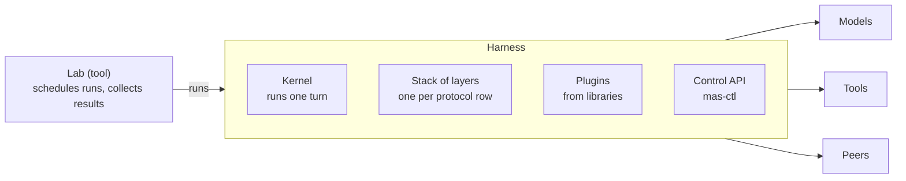

<!--
  Copyright (c) 2026 Cisco Systems, Inc. and its affiliates
  SPDX-License-Identifier: Apache-2.0
-->
# Glossary (manifests & experiments)

This page defines the terms you meet in YAML files and CLI output. Look a term
up here when another page uses it without explanation.

## How we name things

Three words cover most of the confusion: *harness*, *kernel* and *lab*. A
**harness** hosts one agent (or one multi-agent system) and everything around
it. A **lab** runs a harness many times and collects the results. The
**kernel** is the small core inside the harness that runs one turn.

| Term | Meaning |
|------|---------|
| **Harness** | The software that hosts one agent or MAS and everything around it. It runs the agent's turns (the **kernel**), connects the agent to models, tools and peers (the **stack** of layers), applies governance, records what happens (observability) and lets you control a live session (the control API). In this repo the harness is the **runtime package**, the plugins that libraries register for it, and `mas-ctl`. Some pages and code names also use the word for two narrower things: a *harness composition* is a named recipe of kernel operations (`react`, `plan_mode`; see [kernel operations](references/kernel-primitives.md#layers)), and a *harness profile* is an overlay that makes the harness behave like a given agent framework. |
| **Kernel** | The state machine inside the harness that runs one turn of an agent: it takes the next input, calls the model and tools through the boundary contracts, and updates the agent's state. See [kernel operations](references/kernel-primitives.md). |
| **Runtime package** | The Python package `mas-lab-runtime` (import name `mas.runtime`, directory `runtime/`). It holds the kernel and the contracts at its boundary. It is the core of the harness, not the whole harness. In prose, say *harness* for the whole and *runtime package* for this package. The bare word *runtime* stays in package names, imports, file paths, manifest kinds such as `RuntimeEngine`, and code identifiers. |
| **Layer** | One step in a stack. A call enters at the top, each layer hands it to the one below, and the bottom layer (the transport) talks to the outside. Examples: retry, cache, `a2a-framing`, `http`. See [communication stack](references/comm-stack.md#stack). |
| **Stack** | The ordered list of layers, bottom first, between an agent and a transport for one protocol row (send to a peer, call a model, call a tool). Declared with a Flavour `bind` row or a `kind: Stack` infra row. Some pages say *chain* for the same thing. See [communication stack](references/comm-stack.md#stack). |
| **Lab (tool)** | The `mas-lab` command and the `lab/components/` packages (core, bench, controller). It acts as a runtime for experiments: it expands an experiment into runs, schedules them, runs the harness once per run, and collects the traces and results. It is not part of the harness. The folder `*.lab/` is the **Lab (definition)** row below: the input the tool reads. |

| Term | Meaning |
|------|---------|
| **Scope** | A place the controller can list catalog items from: a **library** (`library:<name>`) or a **lab** (`lab:<name>`). The UI never builds a server path. |
| **Catalog item** | One catalog entry of a kind (application, agent, overlay, pipeline, experiment, dataset, tool, skill, scenario). Distinct from a dataset **item** below. |
| **Item id** | `<name>` or `<name>@<version>`. Opaque to the UI: it comes from the backend and is sent back. Never derived from `metadata.name`. |
| **Ref** | The string another manifest uses to point at a catalog item (`samples:calc@v1`). The backend returns `item.ref`; the UI never composes one. |
| **Artifact id** | Opaque id of a file the backend serves (a run output, a trace, a plot). Never a path. |
| **Manifest** | A YAML file that declares one thing: an agent (`agent.yaml`), a multi-agent team (`mas.yaml`), an experiment (`experiment.yaml`), an overlay, a flavour, and so on. |
| **MAS** | Multi-agent system: several agents plus a workflow that says who talks to whom. Declared in a `mas.yaml` manifest. |
| **Agent** | One LLM-driven actor with tools, skills, and plugins. Declared in an `agent.yaml` manifest. |
| **Overlay** | A small YAML file (`kind: Overlay`) merged on top of a manifest. CLI: `-o path/to/overlay.yaml`. It changes one agent setting (tools, memory, budget) without copying the whole manifest. Passing a Control with `-o` is deprecated: use `--control`. |
| **Flavour** | The glue between the logic spec and the infra (`kind: Flavour`): its `bind` links each agent to infra rows and says what this deployment does with it. `spec.control` attaches Control documents. It defines nothing itself and does **not** hold the model endpoint. Leftover keys are accepted and read by nothing. Bundled names: `local` (default), `prod`. See [flavour manifest](manifests/flavour.md). |
| **Control** | A document (`kind: Control`) that holds an observability set and a governance set. A Flavour attaches it to agents by `$all`, `$entry`, `$not-entry`, `$delegates`, ids, or the same agent path as `--override` (`.mas.agent[id]` / `.mas.agent[*]`). See [control manifest](manifests/control.md). |
| **Infra (infrastructure bundle)** | `apiVersion: infra/v1` files that say *where* things are: LLM endpoint and model catalogue (`LLMProxy`, `LLMLocal`), tool servers, application endpoints, LLM cache. Referenced with `--infra-ref` or `infra_refs:` in `config.yaml` (e.g. `standard:openai`, a bundled infra). See [infra manifest](manifests/infra.md). |
| **Lab (definition)** | A folder `*.lab/` (under `labs/`) with `experiment.yaml`, datasets, overlays, and optional custom pipeline steps. It is where you run experiments. It is not a library. See [labs-and-libraries.md](labs-and-libraries.md). |
| **Library** | A folder with `library.yaml` that holds reusable apps, tools, plugins, and code. In a `name:path` reference, `name` is a library name. A library may live inside a lab. |
| **Package** | An installable Python wheel. `mas-lab` is the meta-package that installs the rest. Wheel names are generated into the [packages reference](packages-reference.md). See also the [package map](libraries.md). |
| **Component** | One of the three lab sub-wheels under `lab/components/` (`core`, `bench`, `controller`). Distinct from the internal `mas.lab.components` runtime modules inside core. See [Repo structure](what-is/repo.md#lab-labs-and-components). |
| **Experiment** | The top level of the hierarchy. The `experiment:` block (usually in `experiment.yaml`) names the MAS under test (`application:`), the scenarios, the dataset, the number of runs, and the level hooks that build results. |
| **Application (in an experiment)** | The `application:` block of an experiment: the MAS or agent under test (`app:` catalog id or `manifest:` path, plus `configs_dir:` for overlays). Not to be confused with the infra `kind: Application`, which declares named service endpoints. |
| **Model slots** | `experiment.models` (and `lab.models`): named LLM pins matching Agent/MAS `spec.models[].id`, plus `judge`. Scalar `experiment.model` = `models.main`. `any` inherits the next layer; local `config.yaml` `defaults.model` fills remaining `any` at engine time. |
| **Scenario** | One column of the experiment matrix: a named setup (`id`) with layered overlays (`logic`, `control`, `infra`). Declared under `scenarios:`. |
| **Item** | One case of the dataset (`item:` hooks, CLI `--item`). Older material calls it `test:`. |
| **Dataset** | The input items (prompts, expected fields) the experiment runs over. Referenced as `dataset:` in `experiment.yaml`. |
| **Run** | One execution of the agent or MAS for a given scenario, item, and repeat index. It writes `traces/events.jsonl`. |
| **Environment** | The world around a run: fixtures, clock, timers, triggers and world actions (`environment:` on the experiment, scenario, or dataset item). Not Flavour / Control / Infra, and not Tutorial 0 (machine setup). See [environment.md](manifests/environment.md). |
| **Fixture** | A paired process the lab starts for a run (or item / scenario scope) and always stops. Not `inputs.tool_fixtures` (mock payloads) and not pipeline `service_start`. |
| **World action** | An environment step (`http_call`, `clock_advance`, `sleep`, …) that changes the world, not the kernel. |
| **Trigger** | A `when` → `do` rule. Structured YAML and gdb `break` lines compile to the same model. |
| **Timer** | A trigger whose `when.on` is `timer` (virtual due-time or wall). |
| **Environment event** | One line of `traces/environment.jsonl` (`custom.environment`). Value-free. |
| **`n_runs`** | How many times to repeat each (scenario, item) for variance. Declared under `run.n_runs`. |
| **Benchmark** | `mas-lab benchmark run` — runs the level hooks around execution: the `pre` hooks of a level before it executes, then the runs, then the `post` hooks. |
| **Pipeline** | Ordered **pipeline steps** that read run artifacts and write CSV/PNG under `results/`. A pipeline is not a separate key of the experiment: it is declared as steps in the level hooks (inline, or by reference to a pipeline file). |
| **Level hooks** | `pre:` and `post:` lists of pipeline steps in `experiment.yaml`, one pair per level of the hierarchy experiment → scenario → item → run (`run.pre`, `run.post`, `item.pre`, `item.post`, `scenario.pre`, `scenario.post`, and the experiment-root `pre:` / `post:`). `pre` steps run before that level executes (for example to start a service the runs need); `post` steps run after it (analysis, tear-down). |
| **Pipeline step** | One unit in a level hook (e.g. `extract_trace_stats`, `plotnine`, or `service_start` under `pre:` with its `service_stop` under `post:`). Declared with `name`, `type`, `config`. |
| **Hierarchy levels** | The experiment hierarchy is *experiment → scenario → item → run*. Older material may say *test* for *item*, or *application* for the experiment level; use the names above. |
| **`events.jsonl`** | The machine-readable trace of a run: one JSON object per line (model calls, tool calls, governance, routing). |
| **Exchange log** | Human-readable transcript on stderr during `mas-ctl chat` (`--trace` = summary + timestamps; `--trace full` for the payload dump). Persist with `mas_ctl.trace` in `config.yaml`. Not used for experiment scoring. |
| **Trace cache** | Store of completed run traces. A run with identical inputs reuses the stored trace instead of calling the model again. |
| **SCOPE** | System for Cognitive Observability Provenance and Explainability. Open-source platform whose `norm` normalizer the optional knowledge-graph pipelines can reuse. Docs: [ioc-project.github.io/scope](https://ioc-project.github.io/scope/). See [Tutorial 9](tutorials/09-kg-scope/README.md). |
| **Observability** | Settings that choose the event sinks: a Control's `observability` or `--events*`. Flavour `bind.events` (or `--events-sink`) names infra rows; each row adds its plugin. Native `events.jsonl` is recorded by default unless a Control named the observability list (including `[]`) or leftover agent observability named plugins. Leftover Agent `spec.observability` is deprecated and still applied when no matching Control names that list. |
| **Plugin** | A runtime or pipeline extension registered by a library: a design pattern, memory store, tool provider, or pipeline step. See [labs-and-libraries.md](labs-and-libraries.md#local-plugins). |
| **Contract** | The declared inputs, outputs, and rules of a boundary such as a tool call, a delegation, or a model request. The runtime checks them. See [tool contract](references/tool-contract.md). |
| **MCP / A2A** | Model Context Protocol (remote tools) and Agent2Agent (remote agents). Both are infra adapters. See [Open standards](standards/index.md). |
| **HITL** | Human in the loop: a person approves a tool call before it runs. See [Tutorial 14](tutorials/14-governance-hitl/README.md). |
| **MCE** | Metrics Computation Engine, an open-source set of metrics that score a session with an LLM judge. See [Tutorial 10](tutorials/10-evaluation-metrics/README.md). |
| **System plugin** | A runtime-owned syscall the model may call (`inform_user`, `request_human_input`, `send`, `subagents`, …), listed in Agent `spec.system_plugins`. See [system plugins](manifests/system-plugins.md). |
| **Skill** | A reusable instruction pack for an agent: a procedure, reference files and optional scripts, in a `SKILL.md` folder. See [Tutorial 6](tutorials/06-agent-skills/README.md). |
| **Trace** | The record of one run: the ordered events of the agent, its tools and its delegations. MAS Lab stores it as `events.jsonl`. |
| **Span** | One timed step in a trace, with a start, an end and a parent. OpenTelemetry (OTel) is the standard format for spans. See [Tutorial 8](tutorials/08-telemetry/README.md). |
| **Knowledge graph (KG)** | A trace turned into typed nodes (calls, tools, agents) and edges (who called what). You query it to ask structural questions. See [Tutorial 9](tutorials/09-kg-scope/README.md). |
| **Judge** | A model that scores an answer against a metric, for example answer relevancy. Set it with `experiment.models.judge`. See [Tutorial 10](tutorials/10-evaluation-metrics/README.md). |
| **Session** | One conversation with an agent, with its own history and state. A session can be saved, forked and resumed. |
| **Checkpoint** | A saved copy of a session at a point in time. You can fork it, resume it or go back to it. See [Tutorial 11](tutorials/11-sessions-and-recovery/README.md). |
| **Governance** | Rules that decide whether an action may run: budgets, approvals, allowed tools. Written in a Control, not in the application. See the [governance manifest](manifests/governance.md). |
| **Context window** | The maximum amount of text a model can read in one request. When the history gets too long, MAS Lab trims or summarises it (compaction). |
| **Kernel** | The small state machine inside `runtime/` that checks each contract and runs the plugins. See [kernel operations](references/kernel-primitives.md). |

Runtime internals: see the [`runtime/docs/`](https://github.com/ioc-project/mas-lab/blob/main/runtime/docs/index.md) tree in the repository.

Hub: [references/index.md](references/index.md) · Run traces:
[cli/observability.md](cli/observability.md).

Next: [Tutorial 0 — Environment setup](tutorials/00-environment-setup/README.md).
