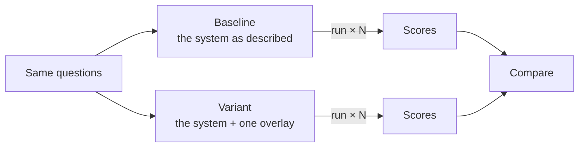
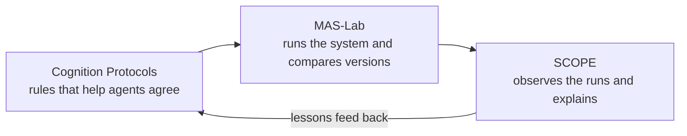

<!--
  Copyright (c) 2026 Cisco Systems, Inc. and its affiliates
  SPDX-License-Identifier: Apache-2.0
-->

# MAS-Lab

<p class="eyebrow">The test bench of the Internet of Cognition</p>

**MAS-Lab is an open-source toolkit for building multi-agent systems and finding
out, with evidence, what makes them better or worse.** You describe a team of AI
agents, run it many times, change one thing, and run it again. MAS-Lab records
every step of every run, so when the behaviour changes you know which change
caused it.

In the [Internet of Cognition](https://ioc-project.github.io/) (IoC), MAS-Lab is
where the other components meet. The
[Cognition Protocols](https://ioc-project.github.io/cognition-protocols/) are
tried out in it, [SCOPE](https://ioc-project.github.io/scope/) is fed from it,
and every measured claim on the IoC site comes out of it.

<div class="grid cards" markdown>

-   :material-file-document-outline: **Describe**

    ---

    Write down the agents, their tools and their rules once. That description is
    the system.

-   :material-layers-outline: **Change one thing**

    ---

    Lay an *overlay* on top: a small change, such as a new skill, a budget or an
    injected fault, that leaves the description untouched.

-   :material-play-circle-outline: **Run and record**

    ---

    Run both versions on the same questions, several times each. Every step of
    every run is kept.

-   :material-chart-box-outline: **Compare**

    ---

    Put the two versions side by side and see what the change did, and whether
    the effect is larger than the noise.

</div>

## Why it exists

Picture a team of agents that investigates incidents in a data centre. A lead agent
reads the alert and asks specialists (network, database, telemetry) for their view.
It works. Then you give the agents a shared memory, and some answers change.
Some improve, some get worse. Was it the memory? A change in the model provider? The
order in which specialists happened to reply? In most code bases you cannot tell,
because the prompts, the tools, the wiring and the rules are all mixed together.

It gets harder. Many multi-agent failures raise no error at all. A specialist agrees
without checking. Two agents use the same word for different things. The lead acts
before the others have reconciled their views. The final answer still arrives, on
time, so monitoring sees nothing.
[Why this happens](https://ioc-project.github.io/overview/motivation/) shows how
much accuracy these silent *cognitive failures* cost.

To surface them you need to **reproduce them under control, watch what happens, and
compare with the healthy system**. That needs a written description of what the
system should be, a way to run it under control again and again, and a record of
every run. MAS-Lab provides all three.

## Four ideas to know

Everything in MAS-Lab builds on four ideas. None of them needs code.

**The description.** A system is described in a few configuration files: who the
agents are, which model each uses, which tools and skills it has, and how they talk
to each other. MAS-Lab reads the description and checks, while the system runs,
that it stays within it. Because the description is the system, two people who run
the same description run the same system.

**The overlay.** An overlay is a change written on its own, like a transparent sheet
laid over a drawing. It can add a skill to some agents, cap their budget, swap a
model, or break something deliberately, for instance by making specialists ignore
each other's evidence. The original description is never edited, so you can stack
overlays, remove them, and always get back to where you started.

**The experiment.** An experiment names the versions to compare, usually the
unchanged system (the *baseline*) and one or more overlays, and the questions to
ask them. MAS-Lab runs every version on every question several times, because a
language model rarely answers the same way twice. This is an **A/B test**: since
only the overlay differs between the two versions, a difference in the results is
the effect of the overlay.

**The record.** Every run leaves a complete record: each message, each tool call,
each model call and each decision, in order. The record is what you score, what you
replay without paying for the model again, and what you send to SCOPE.



A **lab** packages one such experiment with everything needed to repeat it: the
systems, the overlays, the questions, and the analysis that turns runs into
figures. [Discover → Labs](discover/labs.md) lists the labs behind the IoC
results and the paper experiments shipped with this toolkit.

## How MAS-Lab ties IoC together

Each IoC component answers a different question. The Cognition Protocols ask *how
should agents reach a shared understanding and a shared decision?* SCOPE asks *what
did the agents actually do, and where did their thinking go wrong?* MAS-Lab asks
*does a given change really help, and by how much?* Put together, they form a loop.



1. **Provoke.** MAS-Lab applies an overlay that introduces one known cognitive
   failure into an otherwise healthy system.
2. **Observe.** The runs are sent to SCOPE, which rebuilds what each agent did and
   names the failure it finds.
3. **Respond.** The Cognition Protocol meant for that failure is added to the agents
   as a skill, through another overlay.
4. **Measure.** MAS-Lab runs the system again and compares it with the baseline:
   how many failures were repaired, and what the protocol cost in time and tokens.

Each component gives the others something they could not get alone.

| Component | What it gets from MAS-Lab | What it gives back |
|---|---|---|
| **[Cognition Protocols](https://ioc-project.github.io/cognition-protocols/)** — ACCORD and CONCORD | A controlled place to develop the protocol skills and an A/B test that measures what they add | The response to a detected failure, ready to be added to any agent |
| **[SCOPE](https://ioc-project.github.io/scope/)** | Runs in which the failure is known in advance, because MAS-Lab put it there. That is the ground truth a detector needs | An explanation of each run: what happened, between which agents, and why it went wrong |
| **Your own system** | The same experiments, rerun on your agents instead of a reference team | A before-and-after measured on your own workload. See [IoC getting started](https://ioc-project.github.io/how-to/) |

[IoC integrations](discover/integrations.md) explains how each connection works.
[Labs](discover/labs.md) walks through the experiments that produced the IoC results.

## Open protocols

MAS-Lab speaks the open protocols the rest of the stack already uses. Each is
an infrastructure adapter: the agent spec does not change when you switch
transport. [Open standards](standards/index.md) is the map.

| Protocol | Role |
| --- | --- |
| [OpenAI Chat Completions](standards/openai.md) | Model calls, including OpenAI-compatible proxies |
| [MCP](standards/mcp.md) | Remote tools |
| [A2A](standards/a2a.md) | Remote agents |
| [Agent Skills](standards/agent-skills.md) ([agentskills.io](https://agentskills.io/)) | Reusable instruction packs |
| [OpenTelemetry](standards/opentelemetry.md) | Traces, through AGNTCY's `ioa-observe-sdk` |

## An example, from start to finish

The reference system for IoC is an incident-response team: a lead agent and five
specialists who must agree on one fix. Each incident has a known right answer.

- **Baseline.** The team as shipped, with no protocol. This is the reference every
  other version is compared with.
- **Provoke.** An overlay leaves the specialists' views unreconciled. In the IoC
  measurements the final fix was still right in most runs, yet the specialists
  failed to converge in 84% of them: one agent acted first and the others followed.
- **Observe.** SCOPE receives the runs and marks the unreconciled disagreement in
  each one.
- **Respond.** A second overlay gives the lead the CONCORD *initiator* skill and each
  specialist the *receiver* skill. When views conflict, the lead now runs a short,
  bounded round in which every specialist scores the candidate fixes.
- **Measure.** MAS-Lab runs both versions on the same incidents, five times each, and
  reports two numbers: whether every agent accepted the decision, and whether the
  decision was right. It also reports the extra rounds and tokens the protocol cost.

The full set-up and the results are on the
[Labs](discover/labs.md#l9-evaluation-labs) page and under
[Cognition Protocol benchmarks](https://ioc-project.github.io/cognition-protocols/benchmarks/).

## Where to go next

This landing page is MAS-Lab's place in IoC. The rest of this site is the toolkit
itself.

| If you want to | Read |
|---|---|
| Understand what the toolkit is, install it, see the architecture | [Getting started](what-is/index.md) |
| Follow a hands-on path | [Discover](discover/index.md) — IoC integrations, tutorials, and labs |
| See which open protocols MAS-Lab speaks | [Open standards](standards/index.md) — OpenAI, MCP, A2A, Agent Skills, OpenTelemetry |
| Look up a configuration file or a command | [User guide](user-guide.md) and [References](references/index.md) |
| Watch runs in a browser | [Web UI](ui/index.md) and [live dashboard](ui/live.md) |
| Look up a word | [Glossary](glossary.md) |

## About the project

MAS-Lab is open source under the Apache 2.0 licence, at
[ioc-project/mas-lab](https://github.com/ioc-project/mas-lab). The current
version is 0.2.0. It needs Python 3.11 or later, and you can install it with Docker
or from a source checkout. The
[release announcement](blog/posts/2026-09-30-v0-2-release/index.md)
gives a short introduction.

### Cite MAS-Lab

The method is described in this paper:

> Augé, J., Carofiglio, G., Grassi, G. and Samain, J. (2026).
> *MAS-Lab: A Specification-Driven Validation Framework for Reliable Multi-Agent
> Systems.* [arXiv:2606.30546](https://arxiv.org/abs/2606.30546).

```bibtex
@article{maslab2026,
  title         = {{MAS-Lab}: A Specification-Driven Validation Framework for Reliable Multi-Agent Systems},
  author        = {Aug{\'e}, Jordan and Carofiglio, Giovanna and Grassi, Giulio and Samain, Jacques},
  year          = {2026},
  eprint        = {2606.30546},
  archivePrefix = {arXiv},
  url           = {https://arxiv.org/abs/2606.30546}
}
```
