<!--
  Copyright (c) 2026 Cisco Systems, Inc. and its affiliates
  SPDX-License-Identifier: Apache-2.0
-->
# Building the MAS runtime from Mealy machines

This guide explains why the MAS runtime is a product of small state machines, and builds it one machine at a time.
It is written for anyone who needs the reasoning behind the design, not only the diagrams.
The formal reference is [automaton-product-model.md](automaton-product-model.md). Implementation status is in [mealy-envelope.md](mealy-envelope.md).
The guide may describe machines that the shipped kernel has not split out yet.

**Reading order:** requirements (Part I), vocabulary (Part II), one atomic step (Part III), then the building blocks (Parts IV to XII).

## The idea in one example

When the model asks for a tool, the kernel does not call the tool. It publishes a sequence of named events, and each small controller reacts to the ones it cares about:

```text
tool_call_start -> governance_authorize -> observability_pre -> tool_call_execute (the only I/O)
                -> observability_post   -> governance_validate -> tool_call_end
```

The budget policy steps on `governance_authorize` and `governance_validate`. The tracer steps on all seven. The tool controller steps on `tool_call_start`, `tool_call_execute`, and `tool_call_end`. No controller calls another directly.

---

## Part I: requirements

A multi-agent runtime must:

1. Accept a specification (who the agent is, which tools it has, which policies apply).
2. Run a loop: prepare input, call a model, optionally act on the world, repeat until done.
3. Touch the outside world only in controlled ways (LLM APIs, tools, messages to other agents, durable stores).
4. Stay auditable: what went into the prompt, what I/O happened, who decided.
5. Stay governable (budget, permissions, sandbox, human approval) without forking the core loop per policy.
6. Allow swapping parts (model provider, vector store, design pattern) without rewriting the kernel.
7. Compose new behaviour by adding plugins, not by editing one central file.
8. Fail safely: one bad tool call or store timeout must not abort the run.

The usual design is a single loop with hooks:

```text
while not done:
    run_hook("pre_llm"); response = call_llm(); run_hook("post_llm")
    for tool in parse(response):
        run_hook("pre_tool"); run_tool(); run_hook("post_tool")
```

It fails the requirements in predictable ways:

| Requirement | Hook-loop failure |
|-------------|-------------------|
| Auditable | Hooks are optional and ordered by convention; a crossing is easy to skip |
| Governable | Each policy registers ad hoc hooks; no single veto point |
| Swappable | Logic is entangled with the loop; swapping ReAct for Plan-Execute edits the loop |
| Composable | Each feature adds a hook name, and interactions grow combinatorially |
| Closed | Any plugin can import `httpx` and bypass the loop |
| Testable | Testing "did we pause before tool X?" needs a mocked world |
| Provenance | Many code paths mutate `messages[]`; there is no commit point |

The design question is therefore which structure the requirements force.

---

## Part II: vocabulary

The runtime keeps two things in sync: where each controller is (is the run paused, is the prompt being assembled, is a memory read in flight) and the run data (messages, tool results, session flags, correlation ids).

When something happens, the kernel publishes one named event, written σ. Every controller with a rule for σ updates; the others hold.
Any action that touches the outside world follows one recipe, the envelope: announce, check policy, log "before", do the I/O once, log "after", check policy again, close.
Only the execution engine performs real I/O, and only on the "do I/O" step.

In one formal sentence: the runtime is a product of Mealy machines over shared (Q, τ), stepped by a frozen alphabet Σ of input symbols σ. Every side effect is a seven-symbol envelope in Σ. The kernel emits σ and never does I/O. The execution engine runs only on `{op}_execute`.

| Term | Plain meaning | Example |
|------|---------------|---------|
| **Mealy machine** | A small controller with local state that reacts to events σ by changing state or emitting output | `M_tool` is IDLE until `tool_call_start`, then VALIDATING, then EXECUTING |
| **Product (⊗)** | Several machines run at once on the same σ; global state is the tuple of local states | On `governance_authorize`, the budget policy steps and the tool machine holds |
| **Q** | The tuple of all local states right now | `(RUNNING, REASONING, ASSEMBLE, COLLECTING, IDLE, ...)` |
| **τ (tau)** | Shared run data every step can read and write under rules; not the same as Q | `messages[]`, context parts, `call_id`, paused flags |
| **σ (sigma)** | One kernel event; the only way machines interact | `memory_read_execute`, `governance_authorize`, `agent_pause` |
| **Σ (Sigma)** | The complete list of legal σ; the runtime's public ABI, frozen across versions | All `llm_call_*`, `tool_call_*`, `memory_read_*` symbols |
| **Envelope** | The fixed sequence of seven σ for one side effect | `memory_read_start` ... `memory_read_end` |
| **Kernel** | Schedules the next σ and calls `kernel.step(σ, τ)`; never opens sockets or files | Emits `tool_call_execute`, then passes the result into τ |
| **Execution engine** | The only place that performs impure I/O; invoked when σ ends with `_execute` | HTTP call to the model API on `llm_call_execute` |
| **Chokepoint family** | One of five classes of side effect (Execution, Model, Tool, Communication, State) | `memory_read_execute` belongs to State |
| **Hold** | A machine has no transition on σ, so its state stays the same | During `llm_call_start`, `M_mem` holds at IDLE |
| **Macro-machine** | A logical grouping implemented by several machines plus kernel ordering of σ | `M_md` coordinates `M_ctx`, `M_model`, `M_tool` |

---

## Part III: one step of the runtime

Think of a turn-based simulation. Q is a row of dials, one per controller. τ is a whiteboard that everyone reads and writes under strict rules. σ is an announcement on a loudspeaker. On each announcement, a controller with a rule for it flips its dial and maybe updates the whiteboard. A controller without a rule holds. One turn is one σ, and a user request is many σ in sequence.

Before the turn:

```text
σ about to fire:  memory_read_execute
Q = ( q_ctrl=RUNNING, q_md=ASSEMBLE, q_ctx=COLLECTING, q_mem=QUERYING, ... )
τ = { messages: [...], query: "Q3 revenue", call_id: "abc-123" }
```

The kernel calls the execution engine because σ is an `_execute` step. The engine reads the vector store and the result goes back into τ.

After the turn:

```text
Q = ( q_ctrl=RUNNING, q_md=ASSEMBLE, q_ctx=COLLECTING, q_mem=DONE, ... )
τ = { ..., rag_hits: [chunk1, chunk2], call_id: "abc-123" }
```

`M_ctrl` and `M_md` have no transition on `memory_read_execute`, so they held.

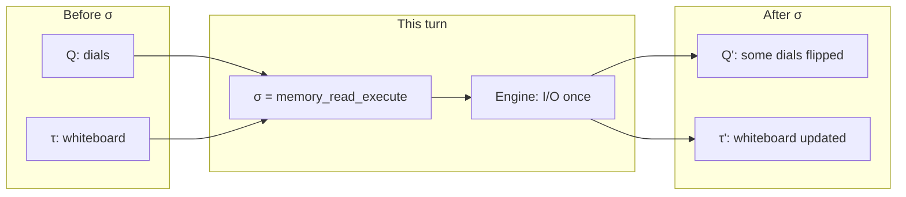

The step relation is `(Q, τ) --σ--> (Q', τ')`. For each machine i in Q: if i has a transition on σ, `q'_i` is the result of that transition; otherwise `q'_i = q_i` (hold). `τ'` is τ after the allowed writes, for example the engine result. The kernel has no other mechanism.

**Why Q is a tuple.** Real runs combine independent facts: the run is PAUSED while the tool controller is IDLE; the design pattern is REASONING while memory is QUERYING. A single `AgentState.REASONING` enum merges unrelated facts and cannot say which sub-protocol is active.

**Why τ is separate from Q.** Q is control (where we are in protocols). τ is data (what we carry). The prompt lives in τ; "may we call the LLM?" lives in Q. Mixing them hides who may write `messages[]` and when.

**Why σ is the only channel.** If plugins call each other or mutate τ without an event, the run cannot be replayed and no one can prove that every crossing saw policy and logging. Every mutation follows a σ the kernel emitted, so traces and tests share one timeline.

---

## Part IV: five chokepoint families

Every side effect passes a mandatory door. Side effects classify by direction and kind:

| Family | What crosses the boundary |
|--------|---------------------------|
| Execution | Run lifecycle (start, pause, checkpoint, stop) |
| Model | Inference on assembled input |
| Tool | Action on external systems |
| Communication | Message or task to another agent |
| State | Read or write of durable or session knowledge |

Context assembly is not a sixth family: it prepares a model crossing. Governance and observability wrap every crossing, and the design pattern schedules crossings. Each family gets a capability machine that owns the protocol for its door. The families are stable; the plugins inside them vary.

---

## Part V: the seven-symbol envelope

Governing and observing every crossing the same way, without custom hook names per feature, requires answering four questions before the world changes: may we do it (authorize), what was the situation before (observe pre), do it (execute, the only impure step), and was the result acceptable (validate and observe post). The example operation is `memory_read`:

| # | σ | Primary movers |
|---|---|----------------|
| 1 | `memory_read_start` | Caller holds; callee arms; observers open a span |
| 2 | `governance_authorize` | Each in-scope `M_gov_i`: ALLOW or DENY |
| 3 | `observability_pre` | Each in-scope `M_obs_j` |
| 4 | `memory_read_execute` | Capability machine and execution engine |
| 5 | `observability_post` | `M_obs_j` |
| 6 | `governance_validate` | `M_gov_i` |
| 7 | `memory_read_end` | Callee returns to IDLE; caller resumes |

Governance is `M_gov` stepping on `governance_authorize` and `governance_validate`: `δ_gov(q_gov, governance_authorize, τ) → (q_gov', ALLOW | DENY)`.
Observability is `M_obs` stepping on every in-scope σ: `δ_obs(q_obs, memory_read_start, τ) → (q_obs', EMIT_SPAN_OPEN)`.
If any in-scope governance machine returns DENY, the kernel does not emit `_execute`. It emits `agent_interrupt` or `agent_abort` instead.

Seven symbols, not three: collapsing authorize and validate into execute hides veto points from replay, and collapsing observability into execute prevents pre and post snapshots. Seven is the minimal explicit factorisation of the four questions.

---

## Part VI: product, not pipeline

Two compositions are often confused:

| Composition | Meaning |
|-------------|---------|
| Sequential A then B | B runs after A finishes; code order matters |
| Product A ⊗ B | On each σ both step if they have a transition; otherwise they hold |

Governance and observability are products with the capability machines:

```text
On σ = governance_authorize:
  M_ctx holds, M_mem holds, M_gov_budget steps, M_obs_otel steps
```

Phase order (assemble before infer) does not come from the product. The kernel scheduler emits an ordered list of σ: `ctx_start -> ... -> ctx_end -> llm_call_start -> ... -> llm_call_end -> tool_call_start -> ...`. The product is parallel on one σ; the kernel orders the list.

---

## Part VII: why individual machines

A single machine with states `{IDLE, PAUSED, ASSEMBLING, CALLING_LLM, EXECUTING_TOOL, WAITING_HITL, ...}` has four problems:

- State explosion: legal combinations multiply (PAUSED and EXECUTING_TOOL?).
- No swap surface: changing ReAct to Plan-Execute rewrites the same chart.
- No plugin boundary: budget and OTel become states or ad hoc flags.
- No test isolation: testing the memory protocol needs the whole chart.

Decomposition gives each concern local state and local transitions. Global behaviour comes from the product and the kernel schedule.

| Machine | Owns | Replaceable without touching |
|---------|------|------------------------------|
| `M_ctrl` | Run gate | Everything below |
| `M_session` | Checkpoint durability | DP, model |
| `M_dp` | Reasoning schedule | LLM provider |
| `M_md` | Think-cycle phases | Individual sources |
| `M_ctx` | Prompt assembly and commit | Tool backends |
| `M_model` | LLM protocol | RAG layout |
| `M_tool` | Tool and HITL protocol | Model |
| `M_mem` | Store protocol | Design pattern |
| `M_trans` / `M_coord` | MAS messaging | Single-agent path |
| `M_gov_i` | One policy's state | Other policies |
| `M_obs_j` | One tracer's buffer | Business logic |

Any adequate architecture for requirements 1 to 8 needs (a) a global control tuple, (b) a frozen crossing protocol for side effects, (c) parallel policy and tracing on those crossings, and (d) one impure executor. A product of Mealy machines over Σ is a standard realisation of all four. It is not unique in theory, but alternatives reinvent the same factors: hook loops implement (b) and (c) informally and lose closure, services without a shared Σ lose replay, and one giant machine loses swap and test.

---

## Part VIII: the machines, in dependency order

### Layer 0: execution engine (not a machine)

Exactly one place may be impure: `engine.execute(σ, τ)`, only when σ is `{op}_execute`. It is not in Q. The kernel calls it after governance authorize and observability pre.

### Machine 1: `M_ctrl` (execution family)

Question: may the run advance? It addresses fail-safe operation and operator control.

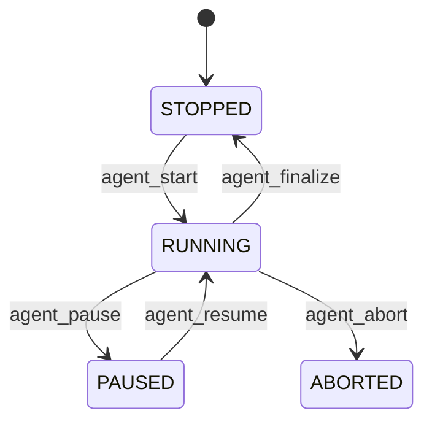

| State | Meaning |
|-------|---------|
| STOPPED | Not running, or finished cleanly |
| RUNNING | Capability envelopes may be emitted |
| PAUSED | Intentional freeze (debugger, operator) |
| ABORTED | Terminal hard stop |

`ControlContract` maps one to one onto these σ. If `q_ctrl ≠ RUNNING`, the kernel emits no model, tool, or state envelopes.

PAUSED is intentional and resumable. INTERRUPTED is a policy soft stop (budget). ERROR on `M_model` or `M_mem` is a local fail-open. WAITING_HITL lives on `M_tool`: pausing the whole run differs from approving one tool.

### Machine 2: `M_session` (execution family)

Question: how do we snapshot and restore `(Q, τ)`? It addresses resume after a crash.

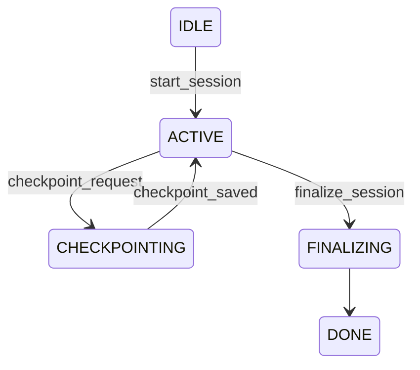

Checkpoints use the envelope: `session_checkpoint_start`, `_execute` (write blob), `_end`. `M_session` stays separate from `M_ctrl` because the lifecycle gate and the durable artifact are orthogonal: you can checkpoint while RUNNING, and you can ABORT without a successful checkpoint.

### Machine 3: `M_dp` (orchestration)

Question: what comes next, think, act, or finish? `M_dp` does not call the LLM; it emits schedule σ only. It addresses swapping design patterns (ReAct, CoT, Plan-Execute).

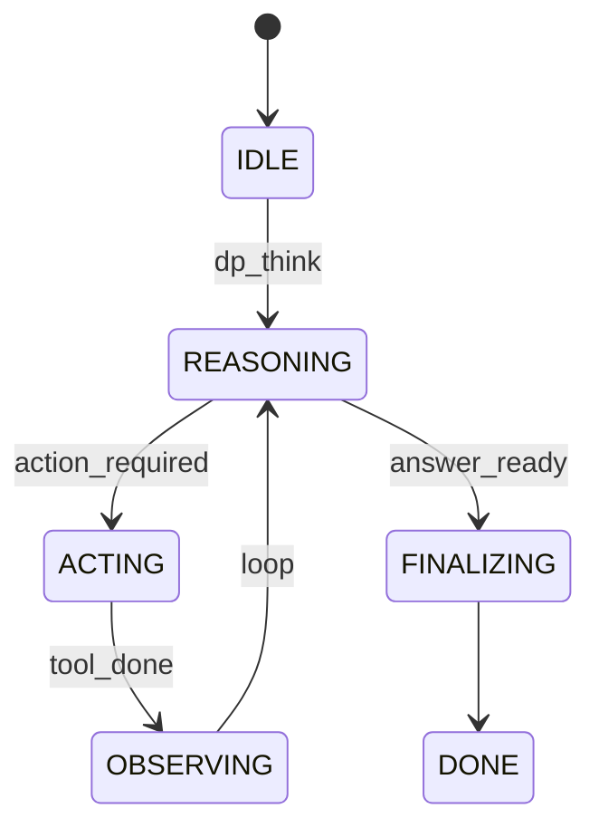

| σ (out from scheduler) | Kernel translates to |
|------------------------|----------------------|
| `dp_think` | Begin the model-dimension think cycle |
| `dp_act` | Begin the act phase (may skip assemble) |
| `dp_finalize` | End the turn |
| `operator_steer_received` (preempt) | Interrupt the in-flight think cycle and rebuild context (`DpState.CTX_BUILD`); the same turn continues |
| `operator_steer_received` (replace) | Discard the in-flight cycle and reset to `DpState.IDLE`; the next `UserInputReceived` starts a new turn |

The design pattern is a policy of ordering, not a protocol of I/O. Swapping `M_dp` swaps behaviour; Σ and `M_md` stay stable.

### Machine 4: `M_md` (model-dimension macro)

Question: are we assembling, inferring, or acting? It is the single place for "one think cycle".

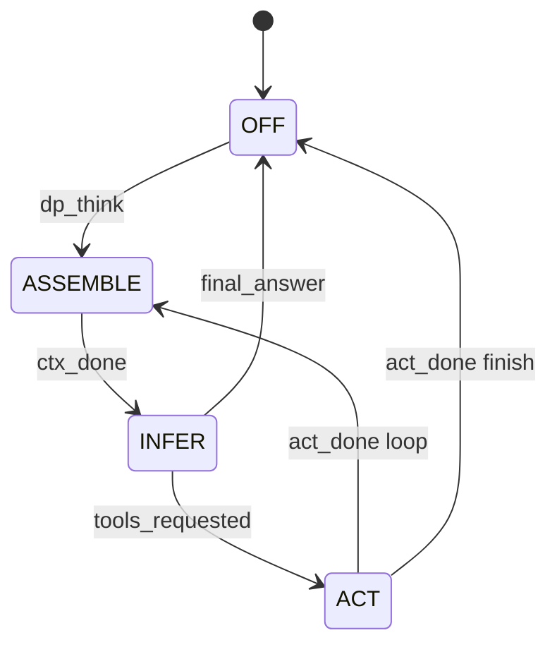

| Phase | Sub-machine | Envelope prefix |
|-------|-------------|-----------------|
| ASSEMBLE | `M_ctx` | `ctx_*` |
| INFER | `M_model` | `llm_call_*` |
| ACT | `M_tool` | `tool_call_*` |

Developers think in "think, then act"; auditors think in envelopes per family. `M_md` is the orchestration view, the sub-machines are the protocol view, and the kernel connects them through σ order.

### Machine 5: `M_ctx` (model family, preparation)

Question: what is in `messages[]` for this inference? It addresses audit (what entered the prompt) and composable context sources. Context assembly is mandatory preparation before `llm_call_execute`, not a sixth impure door.

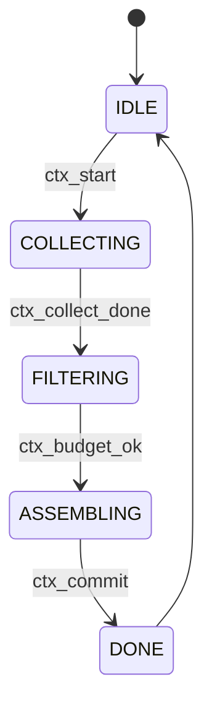

| Phase | What happens |
|-------|--------------|
| COLLECTING | The context manager trims history; sources return `ContextPart`s |
| FILTERING | Token budget on parts |
| ASSEMBLING | Order by placement; commit to `messages[]` |
| DONE | One `ctx_part_recorded` σ per part (provenance track A) |

`ctx_commit` is a governed transition: it runs `governance_authorize` and `governance_validate` on the write to `messages[]`. The context manager (`manage_history`) is a phase inside COLLECTING and FILTERING, not a bypass around envelopes. Sources implement `collect_context(request)`; the assembler knows only parts and envelopes, not whether a part is RAG, a role, or a tool catalog.

If a source needs the store, the kernel inserts a full `memory_read_*` envelope while `q_ctx = COLLECTING` (the parent holds). It is the same `M_mem` that a tool uses later.

### Machine 6: `M_mem` (state family)

Question: how do we read and write durable state under policy?

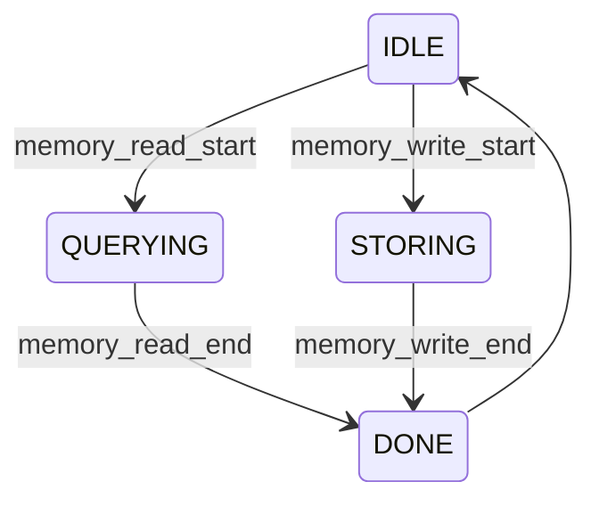

One machine serves every caller: context collect, tool execute, post-turn write. Whenever the store is touched, the same seven-symbol envelope runs; otherwise provenance and governance scope leak.

### Machine 7: `M_model` (model family)

It addresses swapping LLMs and governing tokens and rate limits.

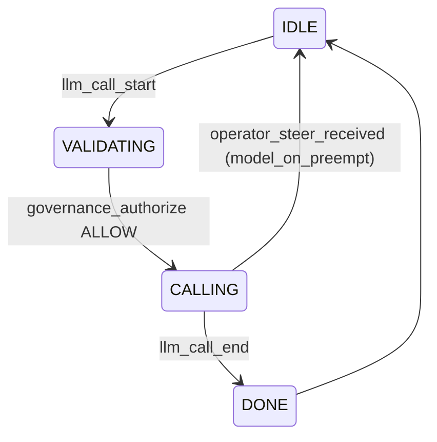

The envelope is `llm_call_start` ... `llm_call_execute` (engine) ... `llm_call_end`.

`operator_steer_received` is not `llm_call_end`. The decode is cancelled mid-stream: `finish_reason` is `preempted` or `replaced` instead of `stop`, no client response is emitted, and `model_on_preempt` (not `model_on_ingress`) drives `CALLING → IDLE`. `M_dp` then decides what runs next (Part XIII).

One `llm_call_execute` may return many tool intents. The kernel queues several `tool_call_*` envelopes, and the DP serialises or parallelises them per policy.

### Machine 8: `M_tool` (tool family)

It addresses permissions, sandbox, human-in-the-loop (HITL) approval, and fail-open on tool error.

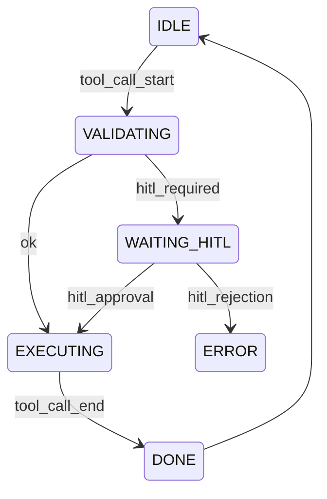

HITL lives here, not on `M_ctrl`: a human approves one invocation (`hitl_approval` σ), while a run-level pause remains `agent_pause`.

### Machines 9 and 10: `M_trans`, `M_coord` (communication family)

They cover multi-agent messaging, delegation, and barriers over parallel calls, using the same envelope pattern (`message_send_*`, `delegation_*`, `barrier_*`). A single-agent kernel can omit them.

### Machines 11 and 12: `M_gov_i`, `M_obs_j` (cross-cutting)

Each governance or observability plugin instance is a Mealy machine in the product, not a layer on top.

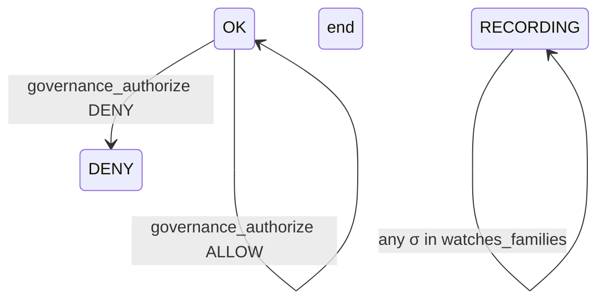

Scope comes from manifest keys, not hook names:

```yaml
governance:
  - id: budget
    watches_families: [model, tool]
    steps_on: [governance_authorize, governance_validate]
observability:
  - id: otel
    watches_families: [execution, model, tool, communication, state]
```

On each σ the kernel steps every `M_gov_i` and `M_obs_j` whose watched families include `family(σ)`. Adding a budget policy registers another `M_gov` with a scope and does not touch the main loop.

---

## Part IX: the full product

```text
Agent =
  M_ctrl ⊗ M_session ⊗ M_dp ⊗ M_md
  ⊗ M_ctx ⊗ M_model ⊗ M_tool ⊗ M_mem
  ⊗ M_trans ⊗ M_coord          (when MAS)
  ⊗ M_gov₁ ⊗ … ⊗ M_govₙ
  ⊗ M_obs₁ ⊗ … ⊗ M_obsₘ
```

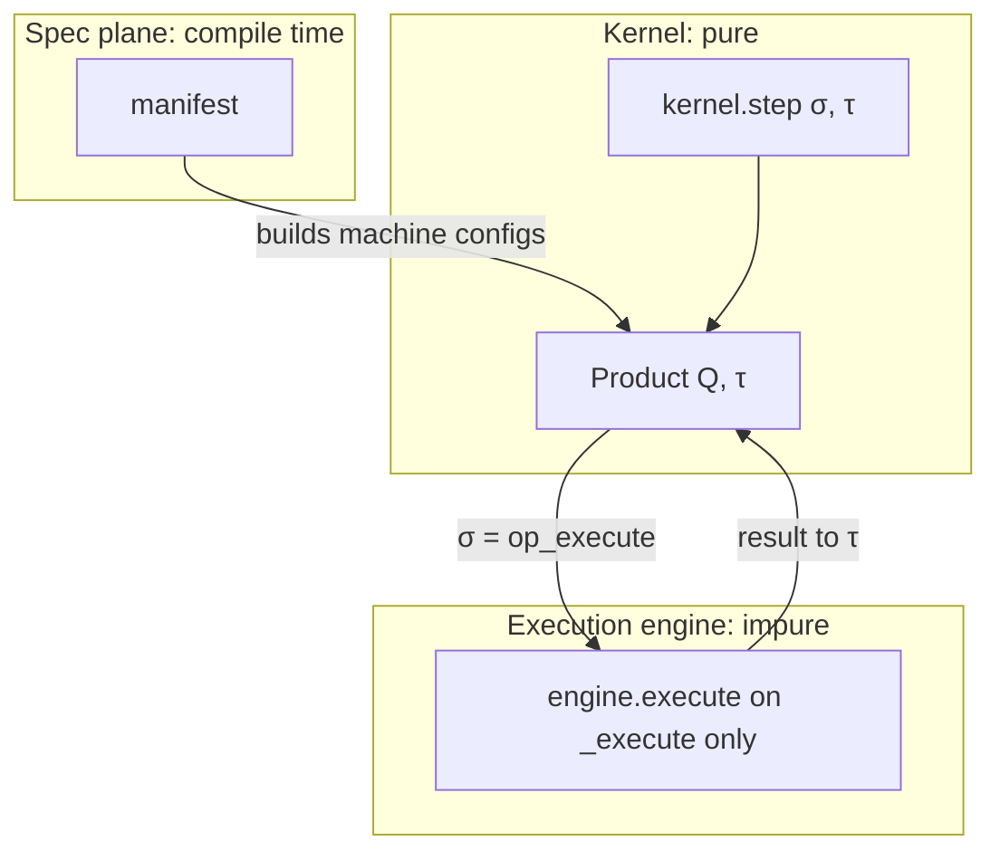

Machines communicate only through σ, usually inside envelopes. Developer APIs (`collect_context`, `ToolContract.execute`) are lowered to σ sequences by the kernel.

## Part X: worked example, one think

The user asks "Summarise Q3 revenue". A RAG source reads memory, and the model returns `send_email`.

| Step | σ | q_ctrl | q_md | q_ctx | q_mem |
|------|---|--------|------|-------|-------|
| 1 | `agent_start` | RUNNING | OFF | IDLE | IDLE |
| 2 | `dp_think` | RUNNING | ASSEMBLE | IDLE | IDLE |
| 3 | `ctx_start` | RUNNING | ASSEMBLE | COLLECTING | IDLE |
| 4-7 | `memory_read_*` envelope | RUNNING | ASSEMBLE | COLLECTING | QUERYING, then IDLE |
| 8 | `ctx_commit` | RUNNING | ASSEMBLE | DONE | IDLE |
| 9 | `llm_call_*` envelope | RUNNING | INFER | DONE | IDLE |
| 10 | `tool_call_*` envelope | RUNNING | ACT | DONE | IDLE |

On steps 4 to 7 and 9 to 10, in-scope `M_gov_*` step on `governance_authorize` and `governance_validate`, and in-scope `M_obs_*` step on every σ of the envelope.
Provenance track A is valid at `ctx_commit` if the nested envelopes completed with matching `call_id` in τ. Track B is the σ trace itself.

## Part XI: what you implement

The decomposition reduces the implementation to two functions and machine registration:

```text
kernel.step(σ, τ) -> (Q', τ', outputs)   # pure
engine.execute(σ, τ) -> result           # impure; only *_execute
```

| Task | What you do |
|------|-------------|
| New policy | Add an `M_gov` instance and a manifest scope |
| New tracer | Add an `M_obs` instance |
| New context source | Implement `collect_context`; the kernel handles nesting |
| New design pattern | Replace the `M_dp` graph |
| New model provider | Register an engine backend; `M_model` is unchanged |
| Test | Assert `(Q, τ)` after stepping σ; mock the engine only on `_execute` |

Features become new rows in Q or new σ in Σ, not surgery on a central object.

## Part XII: three planes

| Plane | When | Role |
|-------|------|------|
| Logic (spec) | Compile or start | Manifests, topology, policies resolve to config |
| Control (kernel) | Run | Product, Σ, envelopes |
| Infrastructure | Bind at start | Flavours, endpoints, secrets map to engine backends |

The same manifest with a different flavour gives the same Σ and a different engine; control semantics do not change.

---

## Part XIII: operator surface protocol (ctl)

Interactive ctl surfaces (the stdout console, the curses TUI, future REST and WebSocket) terminate the boundary between the human operator and the kernel product. They do not control concurrency with stdin mutexes or Ctrl+C handling. Only one ingress is legal at a time because the Mealy product state says so.

| Surface prompt | Kernel ingress | Product precondition |
|----------------|----------------|----------------------|
| `You:` / `>` | `UserInputReceived` | `M_ctrl=RUNNING`, not `M_gov=HITL_PENDING`, turn idle |
| `HITL>` | `HitlResolve` | `M_gov=HITL_PENDING` |
| `/pause`, **STOP** | `LifecyclePause` | `M_ctrl=RUNNING` |
| `/resume`, **RESUME** | `LifecycleResume` | `M_ctrl=PAUSED` |
| `/abort`, **ABORT** | `LifecycleAbort` | Not terminal |
| `/steer <text>` | `OperatorSteerReceived` (preempt) | `M_model CALLING → IDLE` (not `DONE`); `M_dp → CTX_BUILD`; same turn continues |

Steering is the only operator ingress allowed while a turn is in flight. The console's `/steer <text>` is always preempt: it stops the in-flight `LLM_CALL` mid-decode, keeps the already-streamed prefix (`model_on_preempt`), and continues the same turn. `ControlContract.steer()` (`mas-ctl control steer --replace` and `--after`) adds two modes the console does not expose:

- **replace**: discard the prefix, stop this decode, and start a new exclusive turn (`M_dp → IDLE`, `ctx_on_abort`).
- **after** (`--enqueue`): leave the live decode alone, queue the text, and run it once the current `LLM_CALL` finishes normally (`enqueue_input(..., action="turn")`).

`cancel_inflight` (A2A `tasks/cancel`) drops the remainder with no follow-up cycle; success is not guaranteed, per the A2A spec. Every other ingress waits until the product accepts it.

Implementation mapping:

```text
OperatorConsole / curses_app
  auto_hitl=False on SessionController.run_turn
  hitl_terminal=None (interactive governance)
  submit_hitl(..., auto_hitl=False) when M_gov pauses

Batch / CI (non-interactive)
  AutoApproveResponder or ScriptedHitlTerminal in-process
```

The stdout `OperatorConsole` and the curses TUI share `hitl_prompt.py` for briefs and `HitlResolve` construction. The TUI adds STOP, RESUME, and ABORT toolbar controls (mouse, Tab, F6 to F8) that map to the same lifecycle ingress as `/pause`, `/resume`, and `/abort`.

The surface adapter serialises Σ_in. It renders one prompt mode at a time (`USER`, `HITL`, or a control command), so it never emits two ingress symbols concurrently. A race such as typing `ALLOW` at a `You:` prompt is excluded by construction and needs no stderr multiplexing. Non-interactive runs wire `HitlResponder` plugins (`auto-approve`, `auto-deny`) so `M_gov` never blocks on an absent operator.

### Manifest loading

Specs load into memory once, whatever their form:

| Form | Example | Loader |
|------|---------|--------|
| Inline dict | `pipeline: [{type: plot, ...}]` | Used as is |
| Path ref | `pipeline: analysis/pipeline.yaml` | `resolve_yaml_path` |
| Library id | `samples:agents/foo/agent.yaml` | `package_refs` |
| App bundle | `{app: trip-planner, name: pipeline}` | `resolve_app_resource` |

After resolution, pipeline, agent, infra, experiment, and deployment manifests share `mas.runtime.spec.source`. Execution does not branch on how the spec was authored.

## References

- [automaton-product-model.md](./automaton-product-model.md): product model and Σ listing
- [mealy-hooks-and-closure.md](./dev/contracts/mealy-hooks-and-closure.md): closure definition
- [mealy-envelope.md](./mealy-envelope.md): implementation status of the envelope
